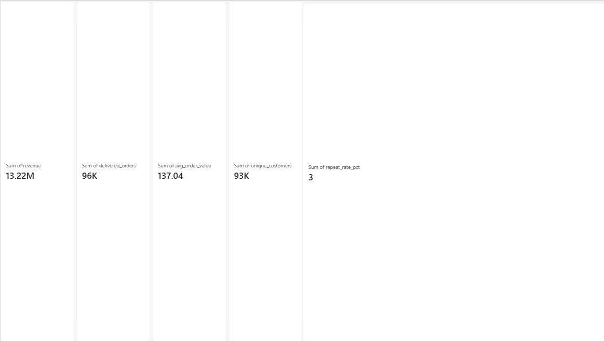
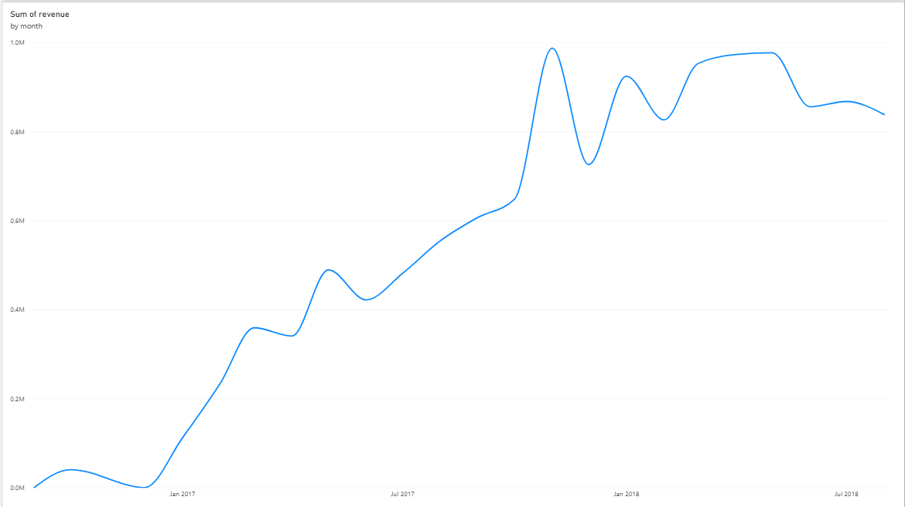
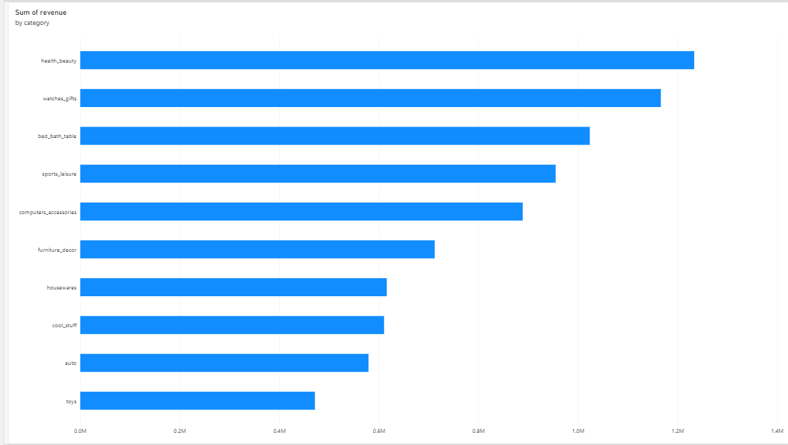
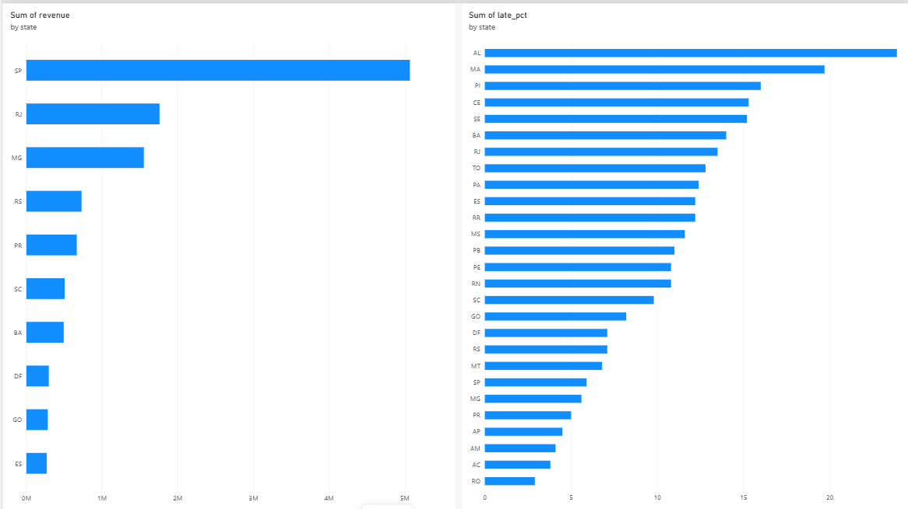
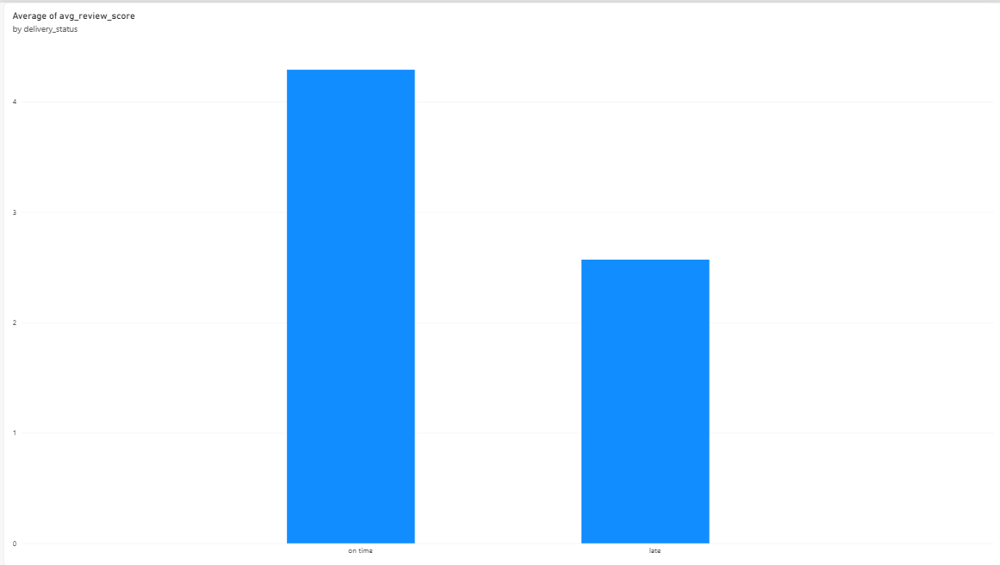

# E-commerce Sales Analysis (Olist)

An end-to-end SQL and Python analysis of about 100,000 orders from a Brazilian online marketplace.
The goal is to answer business questions about revenue, products, regions, delivery and customer satisfaction.

**Tools:** Python (pandas, matplotlib), SQL (SQLite, CTEs, window functions), Power BI or Tableau, Git/GitHub.

## Business questions
1. What are the overall revenue, order count and average order value?
2. How does revenue change month to month?
3. Which product categories earn the most?
4. Which states generate the most revenue?
5. Which states have the worst late-delivery rates?
6. Do late deliveries lead to lower review scores?
7. How do customers pay?
8. How many customers buy more than once?
9. Who are the top sellers, and are they well reviewed?
10. What is the best-selling category in each state?

## Setup
```bash
python -m venv venv
source venv/bin/activate            # Windows: venv\Scripts\activate
pip install -r requirements.txt
```
1. Download the dataset (see `data/README.txt`) and put the CSV files in `data/`.
2. Load it into a database: `python src/load_data.py`
3. Check data quality: `python src/run_sql.py sql/01_data_quality.sql`
4. Answer the questions: `python src/run_sql.py sql/02_business_questions.sql`
5. Make charts: `python src/make_charts.py`
6. Build the dashboard from the CSV files in `outputs/` (see `docs/dashboard_guide.md`).

## Project structure
```
data/        raw CSV files (not committed)
sql/         01_data_quality.sql, 02_business_questions.sql
src/         load_data.py, run_sql.py, make_charts.py
outputs/     query results as CSV (used by the dashboard)
docs/        dashboard guide and chart images
```

## Dashboard







## Key findings

- **Revenue and orders:** 13.22M BRL from 96,478 delivered orders placed by 93,358 unique customers (average order value 137.04 BRL).
- **Growth:** monthly revenue rose from 111,798 BRL in 2017-01 to a peak of 987,765 BRL in 2017-11. In 2018-08 it was 838,577 BRL.
- **Top categories:** health_beauty (9.3% of revenue) and watches_gifts (8.8%) lead. The top 10 categories together make up 62.4% of revenue.
- **Geography:** SP alone generates 38.3% of revenue. The top three states (SP, RJ, MG) generate 63.4%.
- **Delivery:** 8.1% of delivered orders arrived after the estimated date. Among states with at least 100 delivered orders, the late rate ranged from 2.9% (RO) to 23.9% (AL).
- **Reviews:** late orders average 2.57 stars versus 4.29 for on-time orders, a difference of 1.72 stars (7,661 late and 88,163 on-time orders). Late delivery is associated with lower ratings, but this data alone does not show it is the only cause.
- **Customers:** 3.00% of customers (2,801 of 93,358) ordered more than once, so 97.0% bought only once.

## Assumptions and limits
- Revenue means item price on delivered orders. Freight is excluded.
- Currency is Brazilian real (BRL).
- "Late" means delivered after the estimated delivery date.
- The first and last months in the data are incomplete, so their numbers look low.

## Ideas to extend it
- Move the data to MySQL or PostgreSQL (some date functions differ, such as `strftime`).
- Add customer segmentation (RFM analysis) in pandas.
- Predict late deliveries with scikit-learn.
